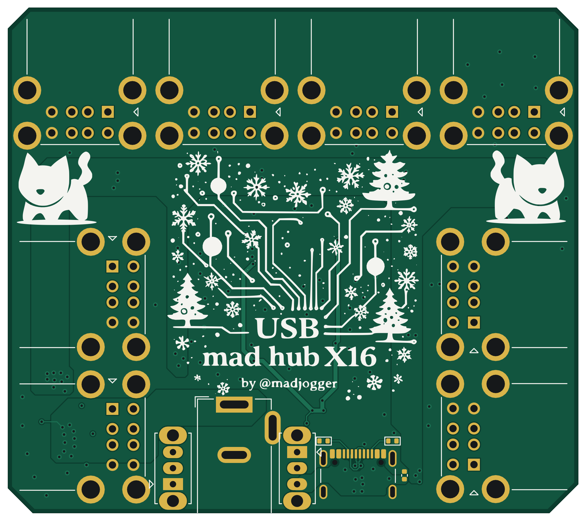
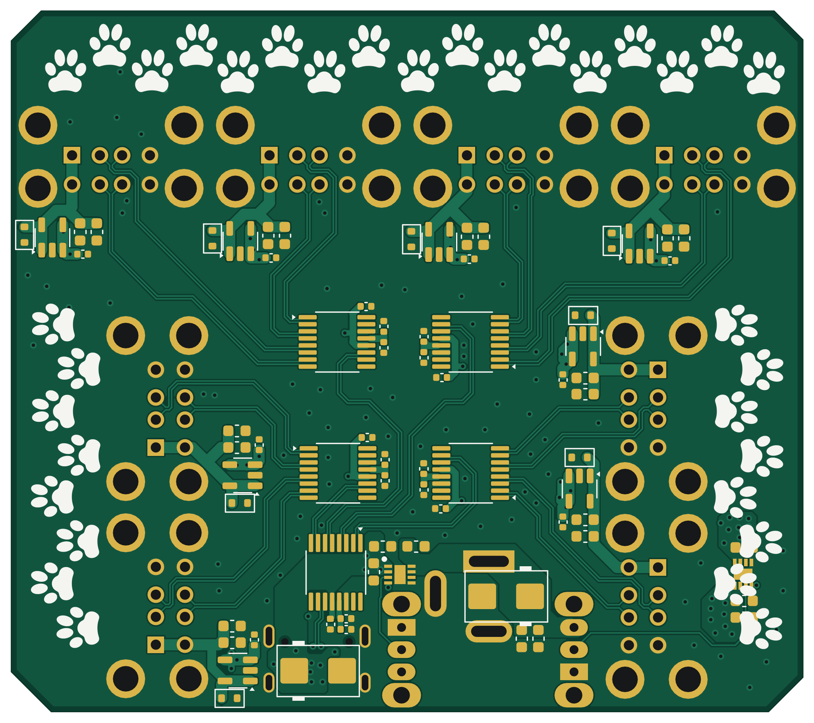

# USB-mad-hub-X16

> **16-port USB 2.0 hub** on five cascaded **CH334R** controllers, with per-connector current-limited power switches, ESD protection and an external power input.  
> Eight stacked dual USB-A connectors on a 71 × 63 mm two-layer board.

<p align="center">
  
  
</p>
<p align="center"><i>Board preview (connector side / component side) generated from the KiCad board file</i></p>

---

## Overview

One CH334R takes the upstream USB-C port and feeds four more CH334R hubs, each serving four downstream ports — 16 ports in total.  
Downstream power can come either from the upstream USB port or from an external supply on the barrel jack; two slide switches and two **TPS22975** load switches select and enable the downstream rail.

---

## Architecture

```
USB-C (upstream) ──► CH334R ──┬──► CH334R ──► 4× USB-A
                              ├──► CH334R ──► 4× USB-A
                              ├──► CH334R ──► 4× USB-A
                              └──► CH334R ──► 4× USB-A

USB-C 5 V ── SW1 + TPS22975 ──┐
Barrel jack ──────────────────┴── SW2 + TPS22975 ──► downstream 5 V ──► 8× AP2822 ──► USB-A VBUS
```

---

## What's on the board

| Block | Part | Purpose |
|:--|:--|:--|
| Hub controllers | 5× **CH334R** | 4-port USB 2.0 hubs, two-tier tree (1 + 4) |
| Downstream ports | 8× stacked dual USB-A | 16 ports |
| Port power switches | 8× **AP2822** | Current-limited VBUS switch, one per dual connector |
| Rail switches | 2× **TPS22975** + 2× slide switch | Bus-power / external-power selection and downstream power enable |
| ESD / surge protection | 8× **PESD5V0S1BB**, 2× **SMBJ12A** | ESD and surge protection |
| Upstream | USB-C (USB 2.0) | Data and bus power |
| External power | Barrel jack | 5 V supply for the downstream ports |

---

## Specifications

| Parameter | Value |
|:--|:--|
| Ports | 16× USB-A downstream, 1× USB-C upstream |
| USB standard | USB 2.0 |
| Board outline | 71.2 × 63.1 mm |
| Layers | 2 |
| Thickness | 1.6 mm |
| Components | 87 |
| Revision | rev0 |

---

## Repository structure

```
USB mad hub X16.kicad_sch   — schematic
USB mad hub X16.kicad_pcb   — PCB layout
img/                        — board previews
```

---

## Development environment

- **Schematic & PCB:** KiCad 9

---

*by [@madjogger](https://t.me/madjogger)*
